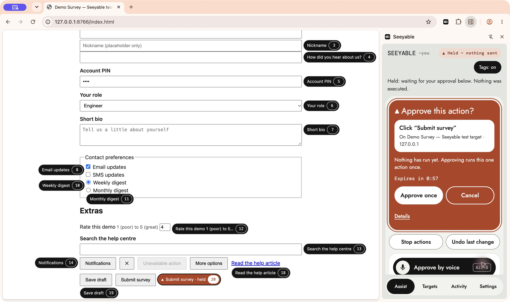
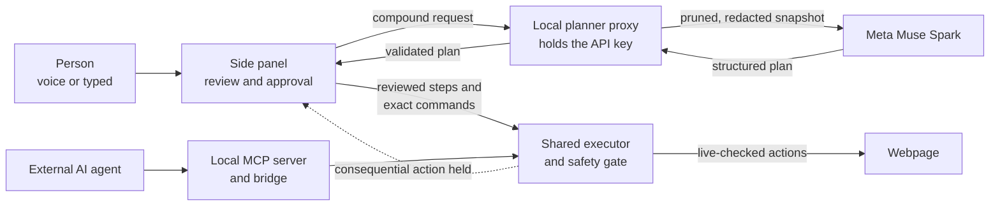

# Seeyable

**Operate the web by voice. Give AI agents the same tools.**

Seeyable is a Chrome extension that turns webpage controls into labeled,
callable tools. People use voice or typed requests in the side panel. External
agents use a local MCP server. Both go through one executor, and neither can
submit, pay or delete without a person approving it.

[Watch the demo](https://youtu.be/5b1S07UP6X4) ·
[Quick start with Docker](#quick-start-with-docker) ·
[Download the judging package](https://github.com/nmheinrich/seeyable/releases/tag/v0.1.0-judging-r3) ·
[Connect an AI agent](docs/local-mcp-setup.md)



*A typed `click Submit survey` request is held for approval and nothing has
been sent. The page is Seeyable's test fixture, not the product.*

## Why it exists

Webpages are built for a mouse and keyboard, and most offer no tools an AI agent
can call. Seeyable adds that layer from the browser, with no changes to the site.
You can say what you want done and review the plan before anything changes. An
agent can work in the same tab under the same rules. Either way, the final
consequential step stays with a person.

## How it works



The planner runs `muse-spark-1.3` through the Meta Model API. It can propose
plans for live execution to be completed by the extension. Alternatively, other 
AI agents can perform actions by invoking the tools available via MCP. 

## Engineering decisions

| Hard problem | Decision |
| --- | --- |
| A page could change after a person approves an action | Approval is bound to a SHA-256 digest of the effective submission: destination, method, submitter overrides and every associated control. Any change revokes it, and the target is checked again in the last synchronous step before dispatch. |
| An agent could try to approve its own action | Approval-shaped fields are never forwarded to the executor. Approval authority lives in the page's content script, and only the side panel can use it, proven by browser-provided sender information. Approvals expire after 60 seconds, run once and die on navigation. |
| Voice approval could be spoofed | It needs the exact phrase, in a listening session the person started while that action was on screen. Typed text, page content, model output and the app's own speech cannot trigger it. |
| Model output is not trustworthy | Plans pass a strict schema and id check at the proxy, a second check against the live page in the panel, and the executor's own guards. Page text is sent to the model as untrusted data. |
| Automation tends to report success it did not confirm | "Dispatched" and "verified" are separate results. An approved action is never retried, and an uncertain outcome stops Undo from reaching past it. Resume cannot revive work that Stop cancelled. |
| Real pages break keyword safety rules | Google Forms answers such as "Very satisfied, response for Checkout experience" were held as checkouts. Two fixes were rejected because they let "Delete" or "Pay now" controls through. The [structural rule](docs/features/feature-11-shared-safety-gate.md) that replaced them still holds those controls and lets the survey answers through. |
| Reading a page through Chrome's debugger is costly | [DOM/ARIA snapshots](docs/decision-snapshot.md) matched Chrome's accessible names on 20 of 20 controls and also record where each name came from. The extension needs no `debugger` permission and shows no debugging banner. This comparison used one test page. |
| Several AI chats competed for one port | Each MCP client joins one shared background bridge using HMAC authentication that never sends the token over the peer link. In a headless run, the bridge recovered from a forced kill with no action replayed. |

All 503 automated tests across the extension, MCP server, planner proxy and
shared contracts passed on 2026-11-04. The planner tests use a stubbed model.

## Real-world use

### Shown so far

All of these used fictional data, and no real form was submitted. "Reported"
means the developer ran the check by hand and recorded no timings.

| Target | What was checked | Evidence |
| --- | --- | --- |
| Google Forms, by voice | Three reported full runs on a real form: repeated rating grids, a conditional section, dictation, undo and a held Submit | [Rehearsal](docs/issue-16-google-forms-rehearsal.md) |
| Google Forms, by MCP | Reported snapshot, highlight, section read, fill and answer clicks using MCP Inspector | [Status log](docs/status.md) |
| Codex agent on the test survey | Fills, select and clicks, with Submit held until a person cancelled it | [Acceptance](docs/evidence/act-2/headed-codex-acceptance.md) |
| Muse Code agent on the test survey | Reported connection, snapshot, fill and page check, using a session-only configuration | [Acceptance](docs/evidence/judge-first-run/muse-code-acceptance.md) |
| Fresh Chrome profile | Install from the ZIP, tags, fill, undo, held Submit and cancel, with no API key | [First run](docs/evidence/judge-first-run/README.md) |
| Docker | Build and start from the ZIP, a live two-field Meta plan and a reported Chrome run of that plan | [Docker checks](docs/evidence/judge-first-run/docker-check.md) |
| Spanish voice | Reported working alongside English as a supplementary check | [Acceptance](docs/evidence/act-2/headed-codex-acceptance.md) |

### Where it could go

These uses are the reason to build it, but none has been tested with users:

- Filling long forms by voice for people who find a mouse and keyboard difficult.
- Giving agents access to internal tools that have no API, without a custom
  integration for each one.
- Letting agents do routine work in a browser while a person approves anything
  consequential.

### Current limits

- Consequential-action detection is heuristic. A dangerous control with a harmless
  label and no submit semantics can pass.
- Snapshots do not traverse shadow DOM or cross-origin iframes. Large-page
  performance has not been measured.
- Speech recognition is imperfect, especially for names and dictated values.
- Undo covers the supported last change. It is not a general rollback.
- Claude clients have documented configuration, but the browser workflow is
  untested. Docker has no separate Submit hold or voice check yet.
- This is a developer setup: load the extension unpacked and run the services
  locally. There is no desktop installer or Meta sign-in flow yet.
- The dependency audit is not clean. It reports a high-severity
  [zod advisory](docs/hackathon-readiness.md#setup-risks-and-follow-ups) whose
  impact has not been assessed.

## Quick start with Docker

You need desktop Chrome 116 or newer and
[Docker Desktop](https://docs.docker.com/desktop/) running. You do not need to
install Node or Python. These commands assume a macOS or Linux shell.

**1. Start the local services.**

```sh
git clone https://github.com/nmheinrich/seeyable.git
cd seeyable
cp -n docker/.env.example docker/.env
chmod 600 docker/.env
docker compose up --build
```

Keep this running. Ports are published only on `127.0.0.1`, and steps 2 and 3 need
no API key.

**2. Load the extension.** Open `chrome://extensions`, enable **Developer mode**,
choose **Load unpacked** and select `apps/extension`. Using the judging ZIP
instead? Select its `extension` folder.

**3. Try it on the test page.** Open <http://127.0.0.1:8765/index.html> and click
Seeyable's toolbar icon. Use fictional data only. Turn on **Tags**, then type each
of these in **Assist**:

| Type this | What should happen |
| --- | --- |
| `fill Full name with Ada Lovelace` | The field changes and the panel says it checked the page. Choose **Undo last change** to restore it. |
| `click Submit survey` | The action is held for approval. Choose **Cancel**, and nothing is submitted. |

For voice, open **Settings → Voice and microphone → Microphone setup**, grant
permission, then return to **Assist** and say `show tags`.

**4. Optional: turn on Muse Spark planning.** This enables compound requests and
needs your own Meta Model API key. Set `MODEL_API_KEY` in `docker/.env`, press
Ctrl+C in the Docker terminal, then run:

```sh
docker compose up --force-recreate
```

Copy the planner pairing token from the output. In the panel, open **Settings →
Advanced → Developer view → Planner proxy (local)**, paste it and choose **Pair
planner**. Then try `Put Ada Lovelace in Full name and Pioneer in Nickname.`,
review the plan and approve it. Never put the API key in the extension.

**5. Optional: connect an AI agent.** With Docker running, open a second terminal
in the same folder and run:

```sh
sh scripts/setup-mcp.sh
```

Choose your agent and add the generated configuration to it. Then open **Settings →
Advanced → Developer view → MCP bridge (local)** in the panel, paste the
copied token and choose **Connect bridge**. This path needs no Meta key, because
the agent uses its own model account.

**To stop,** press Ctrl+C, then run `docker compose down`.

More detail: [Docker guide](docs/docker-quickstart.md) ·
[MCP client setup](docs/local-mcp-setup.md) ·
[Full setup without Docker, commands and troubleshooting](docs/setup.md)

## Repository map

- `apps/extension` — snapshots, word tags, voice/typed panel, shared executor and safety gate.
- `apps/planner-proxy` — loopback planner and Meta Model API credentials.
- `apps/mcp-server` — local stdio MCP tools and automatically shared loopback bridge.
- `apps/demo-survey` — pre-existing survey test fixture.
- `packages/shared` — snapshot/plan contracts and validation.
- `apps/voice-spike` — isolated transcription research; not required for setup.
- `docker` — container build and local service launcher.
- `docs` — feature evidence, acceptance scripts, decisions, and current status.

## Hackathon submission

- **Track / theme:** Indie Developer / Push the Frontier.
- **Runtime Meta model:** `muse-spark-1.3` through Meta Model API. The local
  proxy provides a pruned page snapshot and request; Muse returns a structured
  plan, validated before preview and guarded execution.
- **Bonus category to highlight:** Best Agentic Use-Case. The external-agent workflow was accepted using Codex Work chat; see
  [Act 2 evidence](docs/evidence/act-2/headed-codex-acceptance.md).
- **Open-weight bonus:** not currently claimed; the implemented planner uses
  hosted Muse Spark, not a demonstrated open-weight model stage.
- **Provenance:** the survey is a pre-existing test fixture and is excluded
  from claims of hackathon-built product work. No Seeyable product code existed before October 26, 2026; only the name and
  repository had been prepared. Seeyable is a solo submission.
- **Demo video:** [Seeyable — Operate the Web by Voice. Keep the Person in Control.](https://youtu.be/5b1S07UP6X4)
- **Verification details:** [status log](docs/status.md).
- **License:** [MIT](LICENSE). Bundled fonts retain their included OFL notices.
