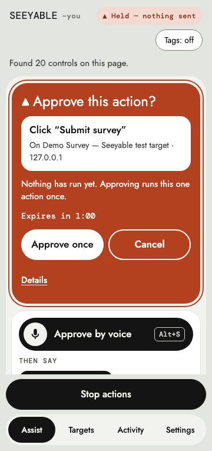
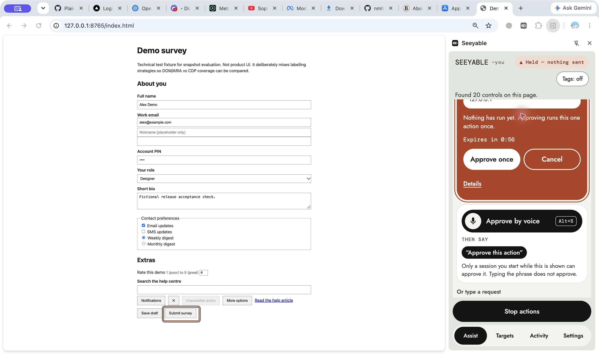
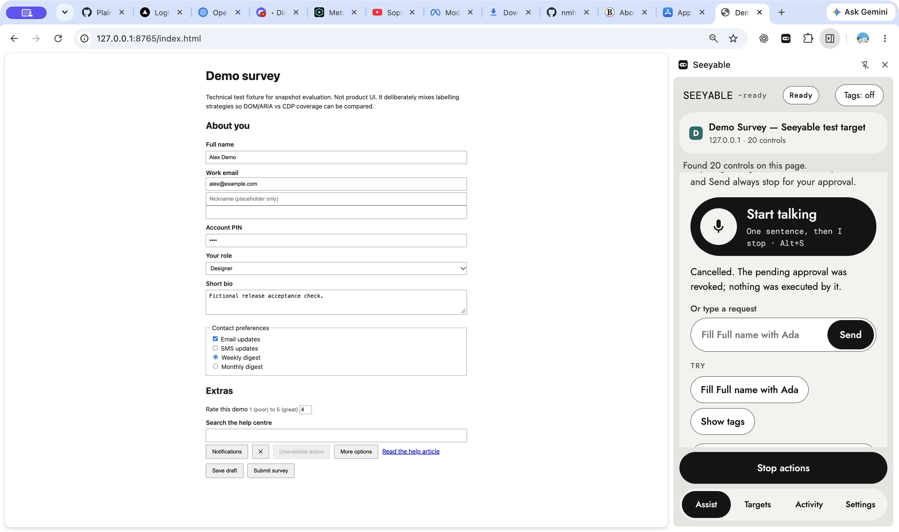

# MCP confirmation delivery investigation — 2026-11-04

## Report and observed limits

The reported MCP click on Submit survey returned `held_for_approval` /
`CONFIRMATION_REQUIRED`, but the user saw no approval card in the open
Seeyable panel. The hold expired without execution. That establishes the
executor's safety result, not the cause of missing UI.

Read-only inspection found the live demo tab and panel open, showing Ready.
A subsequent fresh held request on the same document session / revision 6
**did** display “Approve this action?” for Submit survey. The agent clicked
**Cancel**, observed “The pending approval was revoked; nothing was executed
by it,” and observed all four fictional field values preserved. No approval
was attempted. The original transient failure did not reproduce. The live
extension was not reloaded or patched by this investigation.

The preexisting demo survey is a fixture, not new product work.

## Established delivery gap and change

Before this patch, the worker sent one runtime hint and silently ignored
rejection. With that hint deliberately rejected in an isolated extension
copy, the shared executor held Submit safely, while an already-open panel
stayed on Settings and never discovered it. This was reproduced before the
fix and again using original HEAD versions of `bridge-client.js` and
`sidepanel.js` as a negative control against the final focused test.

The worker now also writes one small session-storage hint, containing only
`tabId` and a unique notification nonce. The open panel observes the storage
change and uses **the existing** adoption controller. The executor remains
authoritative: only its trusted pending-challenge lookup can populate the
card. No challenge ID, request, field value or approval is stored in this
hint. A hint from another tab/area or a malformed hint is ignored, and a
hint with no authoritative challenge displays nothing. Duplicate channels
do not replace the displayed challenge or move focus again.

The worker settles both notification attempts before returning the unchanged
held result; it logs a fixed diagnostic if both fail. Neither failure retries
the executor. This adds no polling, page reload, permissions or approval path.
The original live incident may have had a different cause; this patch does
not claim otherwise.

## Verification

- `npm test --prefix apps/extension`: **429/429 passed**, including executor,
  safety gate, trusted content routes, bridge, panel and plan-review tests.
- Focused genuine Chrome side panel + production extension + stdio MCP +
  real demo survey: **15/15 passed** with normal delivery.
- Same test with the runtime hold hint deliberately rejected: **15/15 passed**.
- Original-code negative control with the runtime hint rejected: held Submit
  remained unexecuted, then `timeout: agent hold in panel` (expected failure).
- `git diff --check`: passed.

The focused browser test fills Full name, Work email, Your role and Short
bio with fictional values via MCP, then holds Submit while the panel is on
Settings. It verifies a visible approval card, reloads the panel while the
hold waits and rediscovers it, cancels, verifies unchanged fields, repeats a
hold on the same tab and cancels again. Submit event count remains **zero**.
No planner/model request or approval is needed in this mode. Browser profiles,
extension copies and service ports are isolated and cleaned up.

Run the safe normal check from the repository root:

```sh
SEEYABLE_E2E_CONFIRMATION_ONLY=1 npm --prefix apps/extension run test:e2e
```

Run the dropped-notification regression:

```sh
SEEYABLE_E2E_CONFIRMATION_ONLY=1 SEEYABLE_E2E_DROP_HOLD_HINT=1 npm --prefix apps/extension run test:e2e
```

Both flags are important: the full existing regression includes approval
and submission checks. The focused mode never approves or submits. The
fault injection modifies only the runtime hint call in a temporary copy;
the executor, content script and panel remain production code. The test
aborts if the injection point is absent. It selects the exact fixture URL,
not the separate pre-install older-tab fixture.



## Patched headed verification — 2026-11-04

The submission-preparedness follow-up independently reran the extension
suite (429/429) and both focused browser modes (15/15 each). Those modes
remain headless; their zero-submit counters are separate from the headed
observations below.

Using the visible Chrome browser, the engineer confirmed the unpacked
extension source was `~/seeyable/apps/extension`, clicked its Reload control,
opened the pre-existing local survey and the genuine side panel, and
restored its existing configured MCP pairing. No model key was needed.

With Settings open and Developer view collapsed, real MCP calls filled:

- Full name: `Alex Demo`
- Work email: `alex@example.com`
- Your role: `designer`
- Short bio: `Fictional release acceptance check.`

Every write returned `verified`. A fresh snapshot bound the Submit survey
target to `doc-yfuwxkl9mw2l3tbc`, revision 5. The first held click at
approximately 20:45 UTC (15:45 Eastern) returned `held_for_approval` and
`CONFIRMATION_REQUIRED`, with nothing executed. The panel switched from
Settings to the existing approval card and focused its heading. The
engineer clicked Cancel, observing: “The pending approval was revoked;
nothing was executed by it.”

Stop then Resume returned to Ready without a repeated hold or navigation.
A fresh MCP snapshot retained the same document session, revision and all
four fictional values. A second request, again with Settings open, produced
a new visible hold, which was also cancelled. A final MCP snapshot again
showed revision 5 and the same values. No approval was attempted and no
submission was observed. Unlike the automated harness, the headed session
did not instrument page submit-event counters.





This closes the pending **agent-observed headed verification** of this
patch. It does not claim a new Product Owner acceptance, reproduce the
original transient incident, or establish arbitrary-page compatibility.
Headed notification fault injection and panel-reload recovery were not
performed; those retain their separate headless evidence.

The source candidate is identified in `candidate-manifest.json` by its
base commit and SHA-256 hashes of the extension runtime and focused change
files. The Product Owner authorized a scoped local commit in the submission-
preparedness chat after reviewing these results. The commit containing this
manifest identifies the verified candidate; no push is included in that
authorization. If the original symptom recurs, collect
panel/worker errors and binding state rather than inferring its cause from
`held_for_approval` alone.
